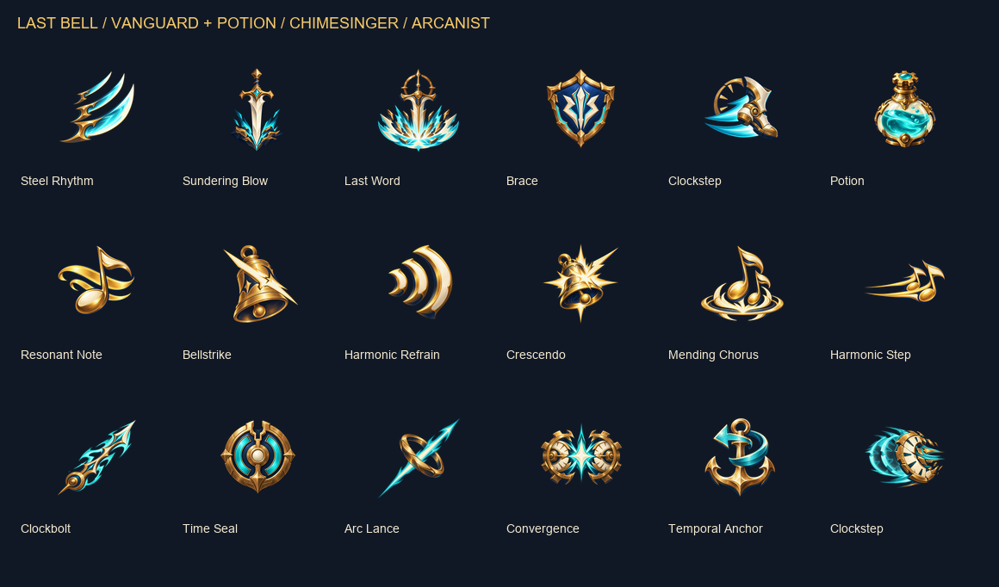

# Last Bell ability icons

18 original generated icons for [request #43](https://github.com/Risxhb/collab/issues/43), including the six Arcanist abilities added by Chzy18. Prepared October 21, 2026.

## Delivered

- Five Vanguard, six Chimesinger, six Arcanist, and one shared potion icon.
- PNG, 256 x 256, RGBA with real transparency. Centered proportional glyphs with at least 31 px clear padding (about 12%).
- Exact requested filenames in `unity/Assets/LastBell/Run/Resources/Run/Icons/`.
- Deterministic Unity GUIDs and Texture2D import settings: sRGB, bilinear, clamp, no mipmaps, alpha transparency, uncompressed, maximum 256 px. The current HUD is IMGUI; load with `Resources.Load<Texture2D>("Run/Icons/<filename-without-extension>")`.
- [Full contact sheet](icons-contact-sheet.png): every icon at native 256 px and 64 px on dark `#101825` and light `#F4E9D1`, plus 64 px grayscale previews.
- [Native 64 px check](icons-64px-check.png) and [compact overview](icons-overview.png).
- [Exact generation prompts](icons-prompts.md), [generation manifest](generation-manifest.json), and [file validation](validation.json).

The contact sheets and documentation live outside Resources so they are not loaded as gameplay textures. Labels belong only to the review sheets; the individual PNGs contain no text or tile frames. Optional status badges are not part of this delivery.

## Validation and remaining integration

All 18 files passed programmatic size, RGBA, transparent/opaque alpha, padding and corner-transparency checks. SHA-256 hashes are recorded. Visual review of the native 64 px color and grayscale previews found distinct action silhouettes: narrow sword strike versus wide slam, bell bolt versus burst, note versus wave versus musical dash, and six distinct Arcanist shapes. Minor painted detail naturally disappears at HUD size.

This is an asset delivery, not a Unity runtime acceptance result. Claude still needs to wire the available kits into the skill bar, preserve key labels/cooldown overlays/tooltips, rerun the build autotest, and provide a gameplay screenshot for human review. Arcanist icons are ready ahead of its gameplay integration; no keybinds or gameplay changes are defined here.

## Reproduce the package

The source images were generated with the built-in ImageGen tool, one call per icon, with transparent backgrounds. `generation-manifest.json` maps each output to its generated source filename and exact prompt. Source hashes are in `validation.json`.

With Pillow installed, run `python docs/ability-icons/package_icons.py <directory-containing-generated-source-PNGs>` from any working directory. It trims only fully transparent outer margins, scales proportionally into a 194 px box, centers on 256 px transparency, and creates the review sheets. It does not repaint the art. Original generated files remain retained locally; final project assets are committed here.
