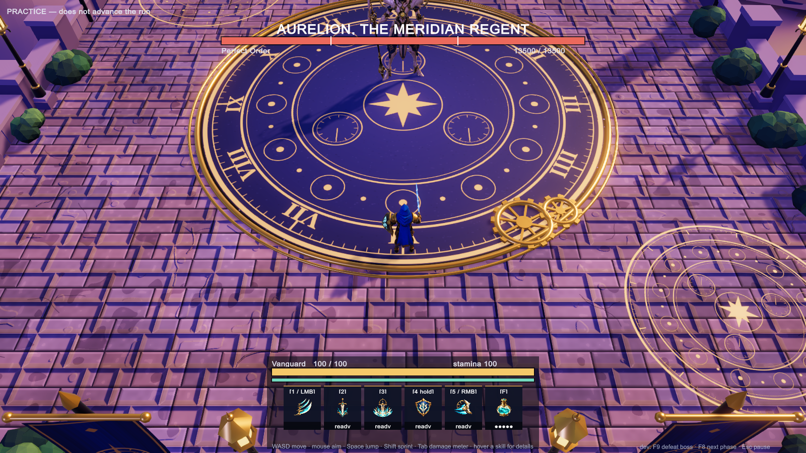
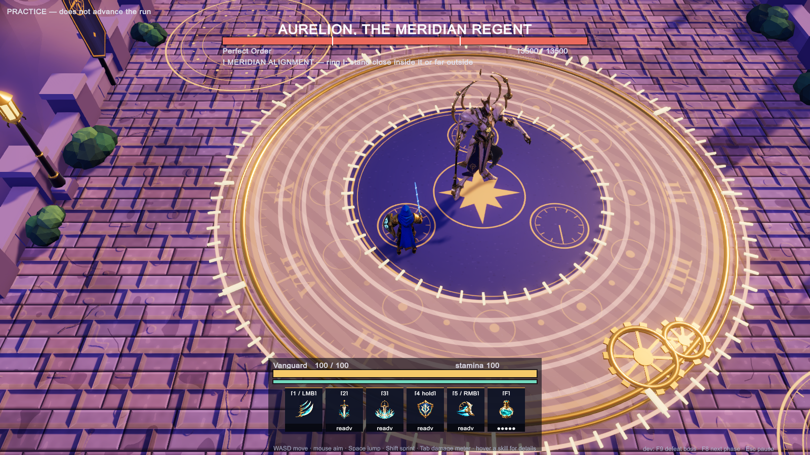
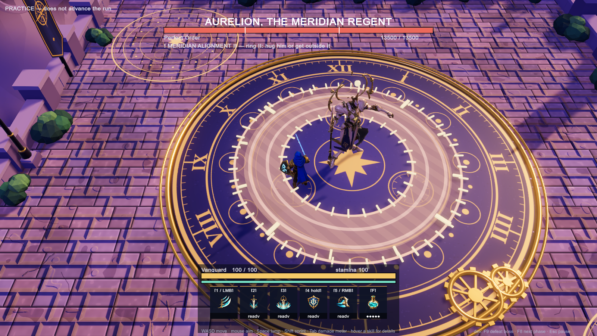
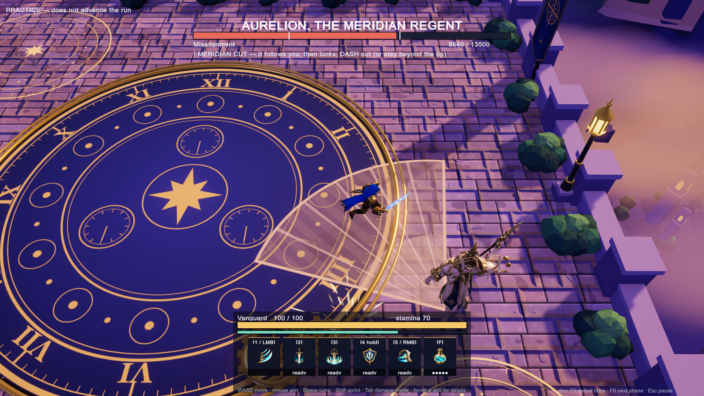
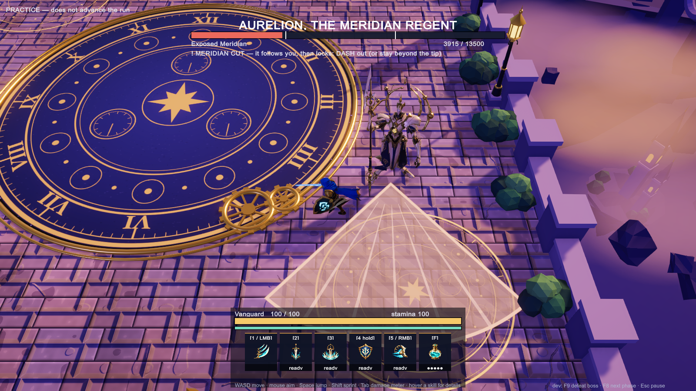

# Aurelion, the Meridian Regent: grey-box encounter

The Skyward Spire area boss, built from Codex's four-boss handoff ([PR #46](https://github.com/Risxhb/collab/pull/46), board [#47](https://github.com/Risxhb/collab/issues/47)). The branch is `feature/boss-aurelion`, stacked on `feature/run-loop` ([PR #42](https://github.com/Risxhb/collab/pull/42)).

Aurelion is a **practice-only slot** for now. Open the menu and pick **Practice one encounter → Aurelion**. The run itself is unchanged. The fight takes place in the shared test arena, not the Skyward Spire scene.

## Model

Aurelion uses Chzy18's Meshy model, made from the multi-view images in `prototype/arena-3d/models/upload/aurelion-{front,side,back}.png`. The images are cut from the model sheet by `tools/aurelion/aurelion_meshy_views.py`. The model is rigged and animated in Blender.

- **Source:** `prototype/arena-3d/models/upload/Meshy/Meshy_AI_Aurelion_1022020536_texture.glb`. Meshy named it "Verdant Bellwarden"; it was renamed when it was copied in.
- **Build:** `powershell -File prototype/arena-3d/models/build-aurelion.ps1`. It runs `blender/aurelion_prep.py` (scales him to 4.2 m with his head centred, and adds glow masks for the cobalt eyes and the chest pendulum), then `blender/aurelion_rig.py`. The output is `unity/Assets/LastBell/Characters/Aurelion/Resources/Characters/Aurelion.glb` (2.9 MB, about 15.6k triangles).
- **Rig:** a humanoid chain plus five rigid bones. The glaive is in the right fist, and its direction is set absolutely, so arm swings never flip it; it slides up the shaft instead of going through the floor. There is also the chest pendulum, the halo, and the left and right halo arc pairs. The waist banners and the centre tabard are pinned to the hips.
- **Clips:** Idle, Walk, MeridianCut, ZenithPins, ProcessionalThrust, CrownReversal, MeridianAlignment, OpenChest, PhaseShift and Defeat. Each attack clip has its strike frame at the attack's resolve time, and the encounter stretches the clip over the attack's warning plus recovery.
- **Checking poses without Unity:** `tools/aurelion/pose_render.py` renders a clip at chosen times.

The code-built figure is now only a fallback, used if the GLB is missing.

## What's implemented

The code is in `unity/Assets/LastBell/Run/Encounters/AurelionEncounter.cs`. The numbers start from the packet. Chzy18 changed several of them on 2026-10-21 (marked ★ below). Times are at 60 Hz.

| Attack | Shape | Warning / tracking stops | Recovery | Cooldown | Damage |
|---|---|---|---|---|---|
| Meridian Cut ★ dash check | 80° cone, 6 m | 1.6 s / after 1.1 s (locks with 0.5 s left) | 1.5 s | 5 s | 14 |
| Zenith Pins ★ dash check | 1.8 m circle on 1 / 2 / 3 players (1, 2–4, 5–8) | 1.75 s / after 1.3 s (locks with 0.45 s left) | 1.4 s | 9 s | 12 |
| Processional Thrust ★ | 2 m lane, up to 9 m, fixed when the warning appears; **hits as he travels** | 1.7 s, then 0.5 s travel | 2.2 s | 11 s | 16 |
| Crown Reversal | rear 120° sector, 4 m | 1.5 s | 1.8 s | 8 s | 12 |
| Meridian Alignment ★ | ring 4–8 m, then ring **2.6–4.6 m** (safe pocket hugging him) | 2.0 s + 1.8 s | 3.0 s (chest open) | 20 s | 14 per ring |

The changes marked ★, Chzy18's decisions on 2026-10-21:

- **Dash checks (Cut, Pins).** The warning shows for about as long as before, but it keeps following you and only locks late. From the worst spot, neither walking (6 m/s) nor sprinting (9 m/s) gets you out after the lock. A dash (3 m in 0.2 s, with no immunity) does. A player standing near the edge of the Cut cone can still walk out. Every pin needs a dash, because it is centred on you when it locks.
- **Thrust damage during travel.** The lane deals no damage when the warning ends. His front (body plus glaive tip) hits whoever is still in the lane when it reaches them, so a late sidestep still works.
- **A real safe spot in ring II.** The inner ring now starts at 2.6 m, which leaves a pocket 1.55–2.3 m from his centre. Melee can hug him through the second pulse and keep hitting, or leave past 4.9 m.
- **Orrery rings.** During each Alignment pulse, dashed gold circles with clock ticks and a riding planet bead are laid exactly on the warning's inner and outer edges. They spin up and brighten toward the pulse, flash, and sink away. They are presentation only, and they never light anything outside the danger shape.

The fight has three phases:

- **Perfect Order (100–65 %).** One attack at a time, with an extra 0.5 s pause after each. Standing at range (more than 7 m) invites the Thrust.
- **Misalignment (65–30 %).** Pins lead into Cut. The Cut's warning starts when the pins lock, so the pins resolve first: two dash checks about 1.2 s apart. Crown Reversal turns on once a player has stood in his rear sector for **more than 3 s**.
- **Exposed Meridian (30–0 %).** Alignment, then the full 3 s open-chest recovery, then a Thrust.

Rules from the packet that the code follows:

- **Phase changes.** A phase change waits until the current attack ends. It plays a 1.5 s transformation that deals no damage and shows no warning. Damage that skips past both thresholds plays a single transition.
- **Overlap.** At most two damaging patterns are live at once. Pins + Cut is the only overlap.
- **Hit-stun.** Every hit stuns for 0.15 s.
- **Charge endpoint.** The Thrust endpoint is clamped to the boss bound, which leaves a 0.9 m corridor along the wall.
- **Pin withdrawal.** A pin whose recipient goes down is withdrawn before it locks.
- **Defeat.** On defeat every warning is cleared. He plants the glaive, kneels, the pendulum stops, and the halo arcs fall inert.

**HP is 13 500.** This follows the packet's rule (measured sustained DPS × 150 s): the autotest measured Vanguard at about 90 DPS while moving and dodging.

## Changes to shared files (small hooks)

- **`RunDirector`:** `PracticeAurelion = 4` as a practice slot, plus `PracticeName()`. The F8 dev key now asks the boss for its next phase fraction through the new `BossEncounter.NextPhaseFraction()`. Bellkeeper behaviour is unchanged.
- **`RunHud`:** a fifth practice button, the hint text for each Aurelion warning, and 65 % / 30 % marks on the health bar.
- **`Hazards`:**
  - `HazardSystem.Cancel(h)`, with `Telegraph.Cancel()` in `BellkeeperFx`, withdraws one hazard without resolving it.
  - `Hazard.HitOnResolve = false` lets the owner deal the hits itself while the warning is up. The Thrust uses this for its moving blade.
- **`RunAutoTest`:** now a `partial` class. The Aurelion section is in `RunAutoTest.Aurelion.cs`. `-lastbellAurelionOnly` runs only that section.

## Evidence: the autotest's Aurelion section (49 checks; full suite 155/155)

**Route proofs** use the real `Hazard.Contains` geometry with the player margin, the boss body and the floor bound. They allow 0.25 s of reaction after the lock. The 4.2 m/s rows are the prototype walk and the 6.0 m/s rows are the design walk.

Attacks you can walk out of (no dash, no jump):

| Attack | Worst walk | Spare at 4.2 m/s | Spare at 6.0 m/s |
|---|---|---|---|
| Processional Thrust | 1.35 m | 1.13 s | 1.23 s |
| Crown Reversal | 2.25 m | 0.71 s | 0.88 s |
| Alignment I | 2.35 m | 1.19 s | 1.36 s |
| Alignment II | 1.30 m | 1.24 s | 1.33 s |

Dash checks (worst spot):

| Attack | Way out | Window after lock | Walk at 6 m/s | Sprint at 9 m/s | Walk + one dash |
|---|---|---|---|---|---|
| Meridian Cut | 2.60 m | 0.50 s | 0.68 s ✗ | 0.54 s ✗ | 0.42 s ✓ |
| Zenith Pins | 2.15 m | 0.45 s | 0.61 s ✗ | 0.49 s ✗ | 0.39 s ✓ |

Further checks:

- **Hug pocket.** Ring II's pocket against his body is safe in all 72 directions.
- **Pins → Cut.** Simulated tick by tick: one dash for the pins and one for the cut clear both from all 54 start positions tested, at both walk speeds.
- **Thrust.** A player standing in the lane is hit during his travel (at tick 130 of the 102 → 132 travel). A sidestep made only after he starts moving avoids it.

**The live fight** uses a bot that walks at 4.2 m/s, reacts 0.25 s after a warning locks, dashes only when walking can't make it in time, and never sprints or jumps. It plays all three phases (one stretch in melee on his flank, one at range, one camping behind him) and **takes no damage**. It needed 8 dashes for Cut and 14 for Pins. The invariants checked are:

- phase queueing, and a single transition when damage skips both thresholds
- the Reversal only after more than 3 s behind him
- ring II only after ring I has resolved
- pins resolving before the cut
- at most two damaging patterns live at once
- nothing appears during phase transformations
- the short hit-stun
- death clears every pending warning

## Notes for the boss review

- **Dash-check windows are tight on purpose.** Once Cut or Pins locks there is 0.45–0.5 s left. That leaves about 0.06–0.08 s of spare time after a 0.25 s reaction plus the dash. If playtests say it's too sharp, lengthening the window after the lock by about 0.1 s still keeps sprinting from being enough.
- **Things the reference sheet suggests that the code deliberately doesn't do.** Phase 2 "broader, more erratic" attacks would mean bigger shapes, so the attack shapes stay fixed.

## Not done yet

- **Stagger.** There is no boss stagger yet.
- **Counterclock.** This is the extra Midnight Toll attack, and the run has no difficulty tiers yet.
- **Media.** No audio yet. The animation is a first Blender pass. The Phase 2 cracked shoulder and the Phase 3 opening chest shutters exist only on the fallback figure; the Meshy model would need extra parts for them. The Skyward Spire arena (from `feature/class-test-arena`) is not used.
- **Two or more players.** Pins assign 1, 2 or 3 circles by party size, but the run only spawns one player.

## Screenshots (autotest run 14, 155/155 passed)

