# Confrontation alternative menu — October 23, 2026

Separate scene: `Assets/LastBell/Menu/ConfrontationMainMenu.unity`.

Preview: **Last Bell > Alternative Menu > Open Confrontation Scene**, then Play; **Preview in Play Mode** also opens it. Workspace launcher: `E:/Collab/Open Last Bell Confrontation.cmd`. The standalone preview uses `E:/Collab/Play Last Bell Confrontation.cmd` after its dedicated Windows build. Default startup/build settings and the original menus are preserved.

Implementation: existing Bellkeeper's Dais scene copied without its viewer/encounter scripts; existing circular clockwork floor, bell towers, bridges, lanterns, banners and character glTF assets reused. Three character presenters play authored Idle clips, retain their own equipment/materials and face the distant boss. Presentation offsets, yaw and scale are configurable per class. Boss uses `Characters/Bellkeeper2` (the project's bell-headed Bellwarden), beneath a wrapper at exactly `(2,2,2)`; source model and gameplay scale are unchanged. No player controller, world, damage system or encounter owner is installed in the preview.

The shared saved class is `SavedHeroSelection.Current` (`LastBell.Menu.Hero` PlayerPrefs), also written by normal HeroSelection. Start Run calls existing `MenuLaunch.Normal`; Boss Rush opens existing Boss-Rush Test Rush setup with the same selected class, rather than adding a new mode. Difficulty uses existing RunDifficulty. Settings uses existing MenuSettings and MenuMusic APIs. MenuInput handles keyboard, mouse and standard controller navigation. Exit stops Editor Play Mode, quits Windows, or returns to the normal menu in WebGL.

Weather: bounded rain/mist geometry (420 rain strips + 26 mist quads, reduced to 180/12 on lowest quality), animated existing banners, restrained torch flicker. Existing pipeline and music owner are reused; no package changes. Wet paving material and reflection probe belong to this scene copy. Fixed perspective camera widens for 4:3; UI respects safe area. No depth of field or motion blur. Atmospheric sound recordings, new cloth simulation and waterfall assets are not supplied by this change; existing music and authored idle/cloth movement are retained.

Validation: in progress; final results/evidence will be recorded after rendered Unity checks. This document does not claim concept-art fidelity or human visual/audio acceptance.

## Rendered validation record

Unity 6000.6.6f1 / URP 17.6.0. Final scene framing was inspected in actual Play Mode captures for Vanguard, Chimesinger and Arcanist. Resolutions: 1600×900, 1280×720, 2560×1080 and 1024×768. Automated checks assert actual framebuffer size, left-foreground hero / middle-distance boss framing, visible navigation, one active hero, animated bones in every Idle clip, exact `(2,2,2)` boss wrapper with unit visual scale, no combat authority, keyboard/controller focus and Settings, audio continuity, saved class reload, Boss Rush setup, all three classes' Start Run / pause / normal-menu return, preview unload and the original menu's Settings.

Pre-logo final Editor flow: **93 passed / 1 failed**. Every functional check passed; the zero-error assertion failed on two existing `SkywardSpireArena.OnValidate` prefab-material errors while randomized runs loaded Skyward Spire. Source: `Assets/LastBell/Areas/Area1/SkywardSpireArena.cs:82,122`, outside this menu's changes. A preceding two-transition Editor pass was **86/86, zero errors**; that narrower result does not supersede the final broader run. Initial framing and incorrect unpaused-return test were corrected; earlier screenshots/logs remain under separately named evidence folders.

Final transparent logo: `Resources/Menu/ConfrontationLogo.png`, generated with built-in imagegen from the user's second cropped reference. [Prompt and provenance](confrontation-logo.md). It is loaded only by this alternative menu.

The first Windows preview build (before logo replacement) succeeded, **0 errors / 46 warnings**. Logo-build and exact-player results are recorded below after completion.

## Visual compromises and limits

The scene uses the project's existing stylized characters and low-poly architectural geometry; it does not reproduce the concept's photoreal materials, volumetric weather or simulated fabric. Existing tower groups, dial, banners, lanterns, model Idle clips and music are reused. Rain and drifting mist use bounded meshes; no new particle/cloth/audio packages are added. Reflections are restrained probe-based reflections, without a new planar-reflection renderer. No waterfall asset or ambient rain/wind/bell recording was available in the inspected production menu assets. Distant lightning flashes are omitted; storm clouds and torch flicker provide movement without flashes. No existing reduced-motion setting was found. A fixed camera avoids continuous camera movement.

Human visual/audio acceptance, physical-controller feel, WebGL build and live deployment are not claimed. No source/wiki/board publication is part of this task. Wiki Updates/Task-List/progress will remain local drafts under the established publication boundary.

## Final Windows preview with generated logo

**95 passed / 0 failed / zero runtime errors**, final rendered Windows player, Unity 6000.6.6f1, test process completed normally. Dedicated logo build: **Succeeded, 0 errors / 46 warnings**. Existing pipeline/shader and obsolete-API warnings remain. This package includes the alternate scene, unchanged normal menu, existing selection screen and all existing playable maps; it does not replace the default project startup scene.

Player: `E:/Collab/builds/confrontation-menu/LastBell.exe`. Keep the complete adjacent player folder. Workspace launcher: `E:/Collab/Play Last Bell Confrontation.cmd`.

[Exact Windows report](validation/confrontation-windows-20261023.txt), [Editor report and existing viewer error](validation/confrontation-editor-20261023.txt). Full local evidence, failed/superseded runs and build logs: `E:/Collab/build-evidence/confrontation-menu-20261023/`.

Actual running Windows captures, after the new logo was installed:

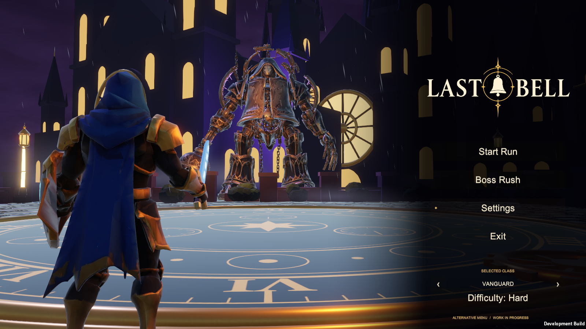

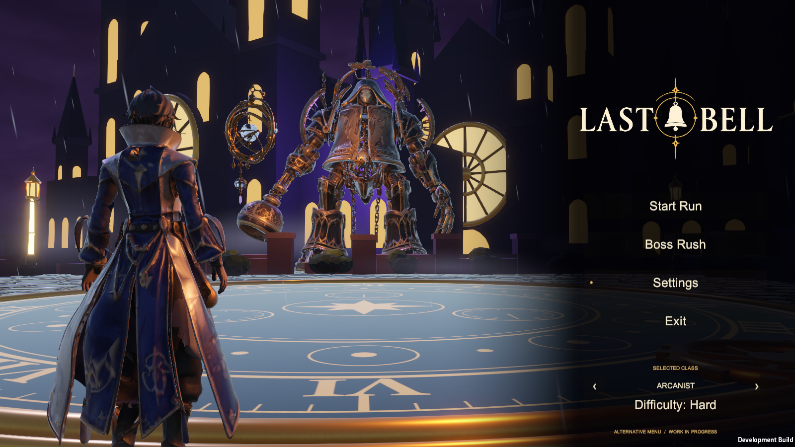

Completed: separate animated 3D menu, all existing class models/Idle clips and shared saved selection, exact doubled presentation wrapper, existing Start Run/Boss Rush/Settings/audio APIs, economical weather, dedicated transparent generated logo, Play Mode and Windows validation, preview launchers and captured evidence.

Next: human visual/listening playtest; richer production environment materials, atmospheric recordings and waterfall/cloth assets can be considered in the existing content lane.

Blocked: no alternate-menu playback blocker. Full Editor zero-error acceptance is limited by the existing Skyward Spire prefab `OnValidate` errors on randomized run entry. No source upload, wiki publication, PR or live-site deployment was requested or performed.

## Saved active menu — follow-up

The user subsequently requested that the active menu remain exclusive until changed. This is now configured under **Settings > UI > Main Menu** in both menus, with Alternative Confrontation currently selected. The choice persists across gameplay/selection exits and application restarts. [Implementation and final 106-check/restart evidence](menu-preference.md). The first build scene is retained, with saved-choice startup routing and both scenes available; this supersedes the earlier preview-only return behavior above.

## Art-direction refinement pass — October 23, 2026

One read-only critic review of actual runtime captures (against `concept.png`), followed by one implementation pass. No second review round. Menu-only changes: shared glTF materials, gameplay, characters, the original menu and packages are untouched. Bellkeeper2 stays under the exact uniform 2× wrapper; only the wrapper position moved.

1. **Damp stone floor.** `WetDial` metallic 0.45 → 0.08, roughness 0.16 → 0.42. `WetPaving` smoothness 0.8 → 0.55, metallic 0.25 → 0.05. Reflection probe intensity 1 → 0.45. Floor/boss-torso luminance went from 2.03 to 1.42. This is better but still above the critic's target of 0.35: the dial still reads blue-grey.
2. **Boss separation.** Menu-only copies `MenuWindowGlow` (42%) and `MenuRoseGlow` (30%) are remapped in this scene only. The violet "Bellwarden silhouette" backlight is at (0,6,-24), intensity 70, range 22. Fog density is 0.012 → 0.02. Boss wrapper is at z -15.
3. **Hero framing.** Camera (0.6,0.75,10.9) → target (-0.6,2.2,-7). Hero is at (1.45,0,8.3). Per-class yaw/offset:

   | Class | Yaw | Offset x | Scale |
   |---|---|---|---|
   | Vanguard | 6 | +0.15 | — |
   | Chimesinger | 4 | +0.1 | 0.97 |
   | Arcanist | 4 | — | — |

   Hero viewport x is 0.16–0.21 at 16:9/4:3 and 0.25–0.27 at 21:9; it was 0.18–0.20. Weapons no longer cross the boss at 16:9/4:3. At 21:9 Vanguard's sword tip still points into the boss's censer arm.
4. **Navigation focus/hierarchy.**
   - Focus cue: the focused item gets a gold label, a short gold underline and a drawn diamond. These are canvas geometry, so no glyph dependency. Unfocused labels are ivory at 78%.
   - Sizes: Start Run is 30 and the other items 26.
   - The class picker stays directly above Start Run, per Risxhb's approved order, but is dimmer and smaller.
   - Difficulty sits closer to the stack, and the footer is 11 → 13.
   - Shared `MenuUI`/`MenuFocus` are unchanged.
5. **Weather.**
   - Rain: streaks are wider (0.022) and softer (alpha 0.34), spanning z -20…+9 across the floor and hero.
   - Mist: lower alpha (0.12). The far band pools at the boss's feet (+0.4 m) instead of a raised strip.
   - Quad counts are unchanged (420/26, or 180/12 on low quality).
6. **Rim and wide screens.**
   - Rim: a menu-only `MenuDampGold` is applied to the two dial-rim ring renderers, and "Hero amber edge" moved behind the hero at (-0.4,1.8,6.4), intensity 6. Bottom rim-band luminance went from 0.40 to 0.27.
   - Wide screens: the contrast gradient now starts at x 0.5 with a steeper falloff. Above 2:1 the navigation column narrows to x 0.76–0.95. Behind-nav luminance at 2560×1080 went from 0.054 to 0.037.

Repeatable scene pass: `ConfrontationMenuBuild.PolishPass` (absolute values). `ConfrontationMenuBuild.Inspect` is a read-only material/light inventory. `-lastbellConfrontationCaptureOnly` runs only the framing checks and captures. Settings captures now use a fixed 1600×900.

Deferred from the critic's list:

- Moving the class picker below the nav stack conflicts with the approved Select Class order.
- Further floor darkening, such as dimming the dial's pale texture/emissive numerals, needs another look-dev iteration beyond this single pass.

### Validation

Windows player `E:/Collab/builds/confrontation-refine-20261023/LastBell.exe`: build **0 errors / 46 warnings**, **106 passed / 0 failed, zero runtime errors**. The run covered all classes and four resolutions, Idle bones, exact 2× wrapper, navigation, Settings > UI switching both ways, saved menu/class persistence, Boss Rush setup, run entry/return for all three classes, preview unload and one music owner.

Editor Play Mode of the same source: **105/106**. The only failure is the zero-error check, from the existing `SkywardSpireArena.OnValidate` prefab-material errors (`SkywardSpireArena.cs:82,122`) during run entry.

The baseline (pre-refinement) player on the same suite scored 106/106. Built from an isolated copy, `E:/Collab/build-isolation/confrontation-refine-20261023/`, because a concurrent session's in-progress TempoTyrant boss files did not compile in the shared checkout. That session's files are excluded from this build and untouched.

[Report and luminance metrics](validation/confrontation-refine-20261023.txt). Full before/final captures: `E:/Collab/build-evidence/confrontation-refine-20261023/{before,final}/`.

Before: 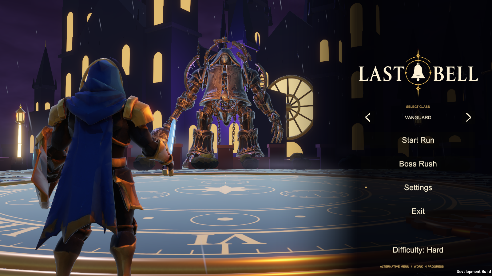

After: 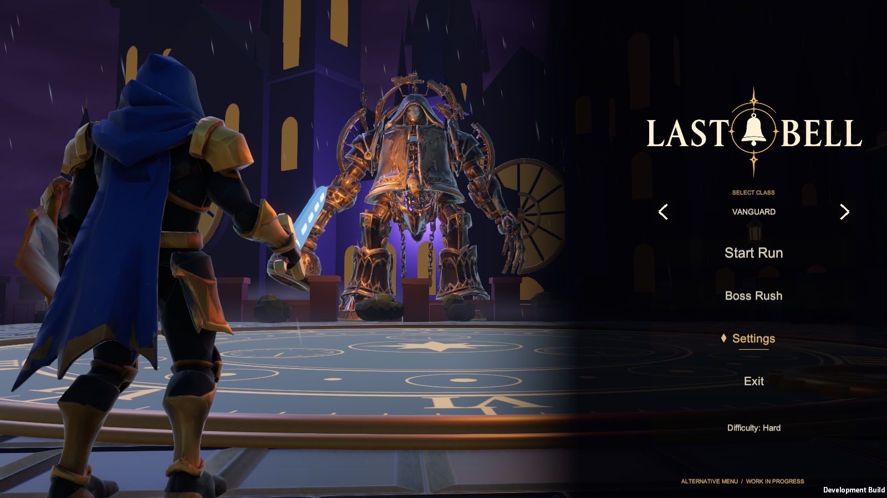 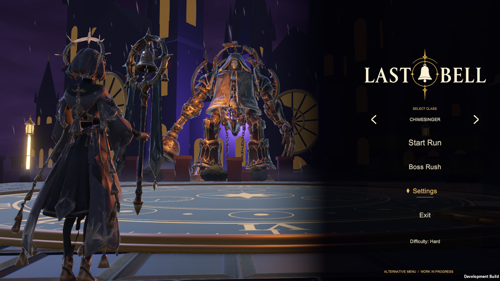 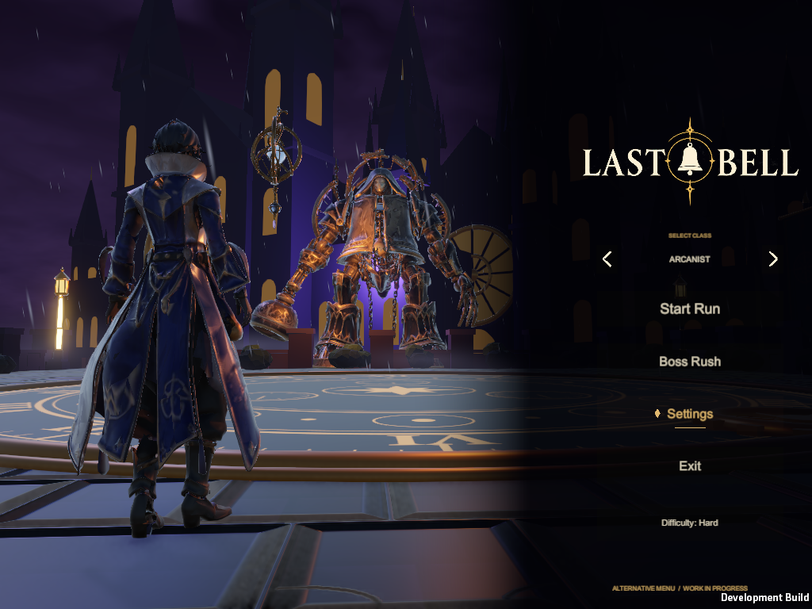 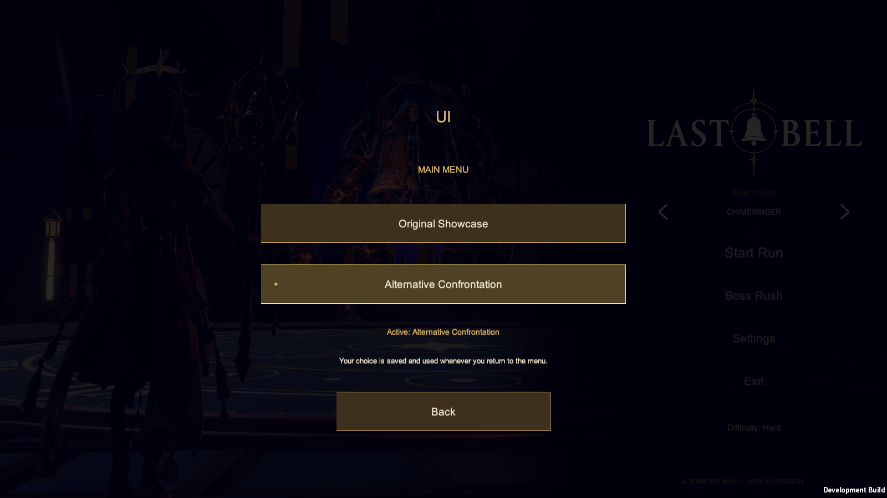

Completed: one critic review, six refinements implemented (one partially), Windows and Editor validation. Next: human visual review; the floor tone and 21:9 Vanguard sword tangency are the remaining compromises. Blocked: none. Local only: no push, wiki/board post or deployment.

## AAA-bar pass — October 23, 2026

Requested follow-up: one more critic pass aiming for 8/10 against shipping AAA title screens (Elden Ring, Lies of P, FFXVI), flagging the placeholder background buildings. The critic scored the first-pass menu **5.0/10**:

| Area | Score |
|---|---|
| Composition | 6 |
| Environment | **2.5** |
| Lighting | 4.5 |
| Characters | 6.5 |
| UI | 5.5 |

It called the key-art towers greybox: flat purple faces, unlit cut-out windows, toy scale, repeated modules and no atmospheric depth. It projected ~8/10 if all seven refinements landed. One implementation pass followed: `ConfrontationMenuBuild.AaaPass`, re-runnable, with menu-only material copies throughout.

1. **Skyline replaced.**
   - Flat key-art towers behind the boss are hidden: `Confrontation bell skyline` and 8 `Island*` groups with z < −14.
   - Seven production Brass Foundry towers (`Areas/Area2/Models/SM_Area2_Tower_Far` ×5, `_Tower_Near` ×2) form a ring 35–100 m out. They use menu copies of the foundry masonry, roof iron, dark brass and slit-window materials, tinted violet-slate (`MenuMasonry`, `MenuRoofIron`, `MenuBrassDark`, `MenuWindowSlit`).
   - The textures come from the existing Area 2 asset pack, so run `setup-assets.cmd` first, as for the arena.
2. **Atmospheric layering.** Fog exp² 0.02 → 0.016 with a lighter violet colour (0.11,0.09,0.19). This gives about 16% haze on the boss, ~47% on the near towers and ~76–90% on the far ring. The critic's 0.032 erased the towers entirely and was rejected after capture. Horizon band is brighter, and the existing "Sea of Clouds" is re-enabled.
3. **Floor.**
   - The pale disc turned out to be the platform body's white paving slots (`Platform/Node-1`) seen through the dial at grazing angles. These now use the menu copy `MenuWetStone`.
   - Roughness/smoothness: dial and stone roughness 0.62, paving smoothness 0.32. The probe is at 0.25. The critic's smoothness 0.7 mirrored the sky at the 0.75 m camera height.
   - Numerals are damp gold, and the rim gold is darker.
4. **Lighting.**
   - The hero's rim and amber edge lights moved behind the hero, and ambient is lowered.
   - A dedicated "Bellwarden front fill" light keeps the boss readable.
   - Three copies of the plaza's own lantern step warm points back toward the boss; none sit behind the menu.
5. **Foreground framing.** Three near-black menu copies of the plaza debris (`MenuForegroundRock`) sit in the lower corners.
6. **UI.**
   - Contrast gradient: starts at x 0.42 with a gentler eased ramp, so there's no hard seam.
   - Palette: labels use the logo's ivory (0.93,0.88,0.76), and focus stays gold.
   - Items: Start Run 28, others 24.
   - Captions: "S E L E C T   C L A S S" is letter-spaced, and Difficulty is a small gold caption. Select Class stays directly above Start Run.
   - No display serif ships in the project, so a licensed serif remains an art need.
7. **Storm.**
   - Rain: a near layer adds 140 long faint streaks in front of the camera.
   - Lightning: `StormSky.shader` gains a menu-only lightning term (global `_MenuStormFlash`, 0 elsewhere). `ConfrontationWeather` drives it with irregular 7–12 s gaps and a ~0.15 s capped double pulse (no regular strobing), plus a small synced lift on the "Sun" light.

Measured, Vanguard 1600×900 and 2560×1080 (`validation/confrontation-aaa-20261023.txt`):

| Metric | Before | Pass 1 | Pass 2 | Critic target |
|---|---|---|---|---|
| Floor / boss torso | 2.03 | 1.42 | **0.92** | ≤ 0.85 |
| Bottom rim band | 0.40 | 0.27 | **0.20** | ≤ 0.18 |
| Behind nav, 21:9 | 0.054 | 0.037 | **0.032** | — |
| Boss torso | 0.261 | 0.293 | **0.307** | must stay ≥ 0.27 |

### Validation

Windows player `E:/Collab/builds/confrontation-aaa-20261023/LastBell.exe`: build **0 errors / 46 warnings**. Two extra warnings from a deprecated API call in the first build were fixed before the final build. Suite **106 passed / 0 failed, zero runtime errors**. Editor Play Mode on the same source: **106/106, zero runtime errors**; the randomized run entry did not load Skyward Spire this time, so its known `OnValidate` error did not appear.

Built from the isolated copy because a concurrent session's in-progress TempoTyrant/Metronome Court work does not compile in the shared checkout. Final scene/materials/code are synced back to `collab/`, local and uncommitted.

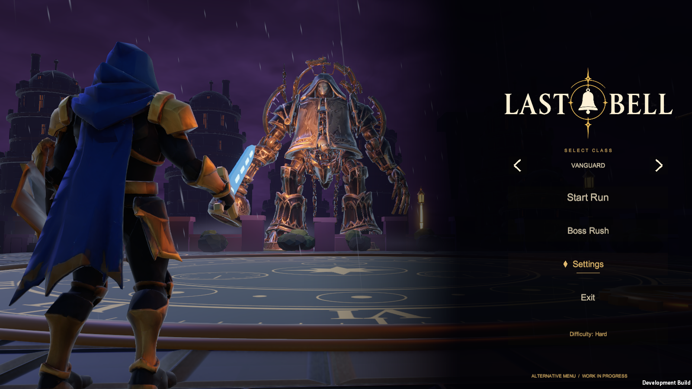 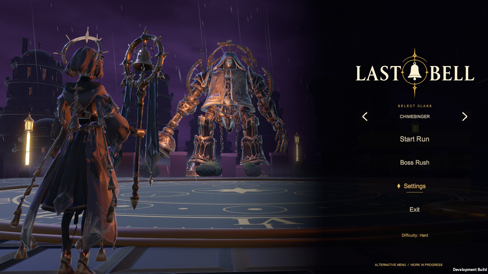 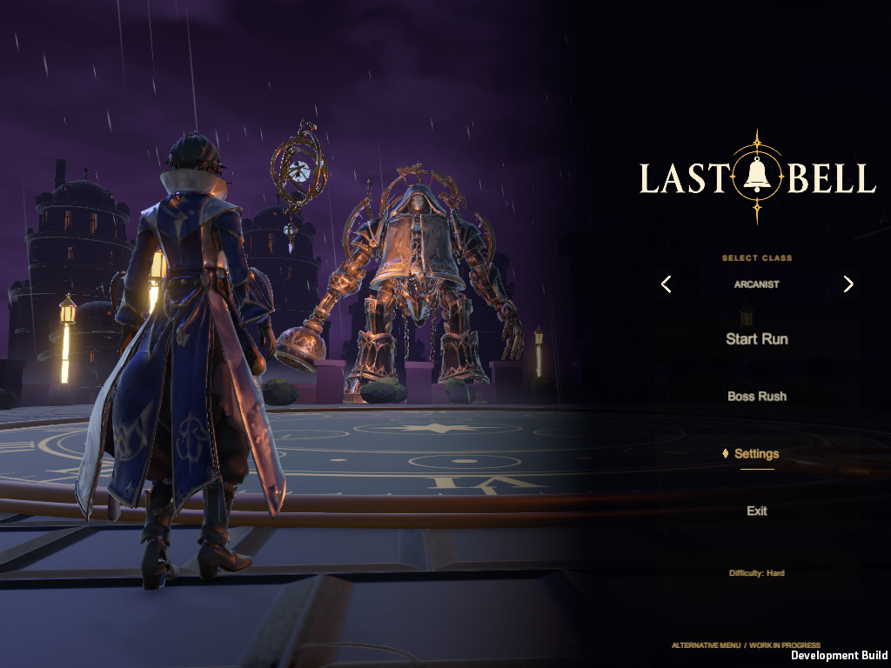 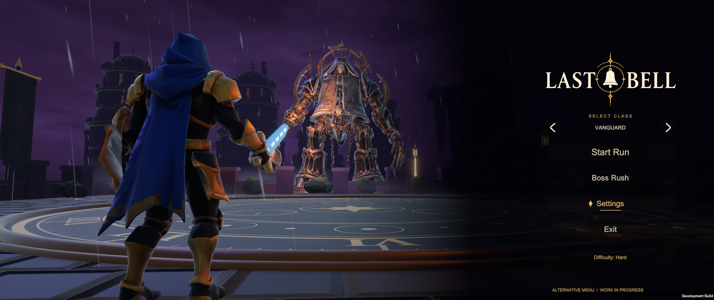 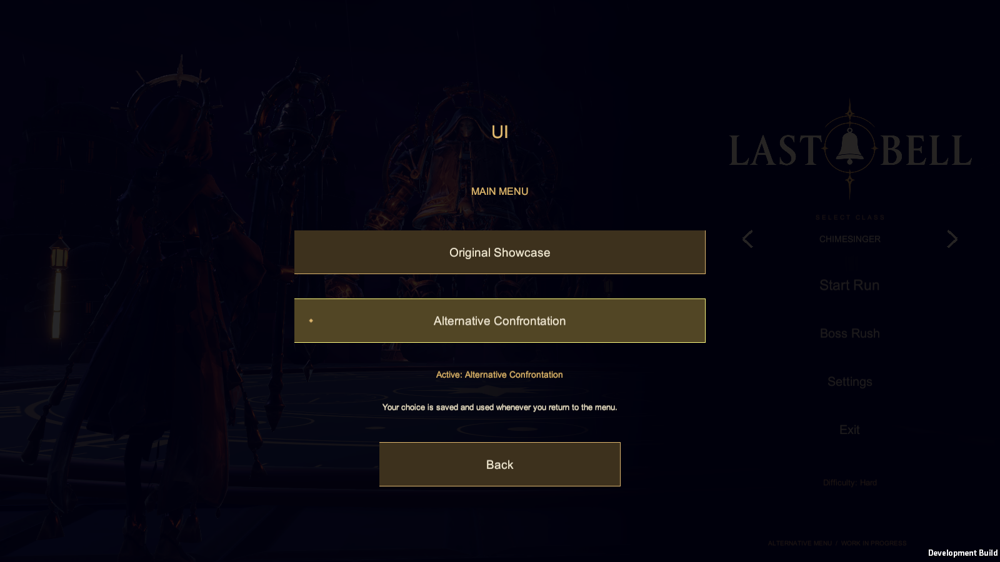

### Limits and remaining compromises

- Lightning is implemented, but no capture caught a flash, so it is not visually verified.
- The tower slit windows, roof domes and masonry come from a foundry kit; they read as production architecture but not as the concept's bell cathedral.
- The floor and rim are close to, but slightly above, the critic's targets.
- Vanguard's glowing sword still crosses the boss's censer arm at 4:3 and 21:9.
- No AAA score is claimed from a self-assessment; that needs human review.
- **Not attempted (needs new authored art):** a purpose-built bell-cathedral skyline with aqueducts/waterfalls, higher-fidelity hero models and wet shaders, volumetric light/fog, authored storm VFX, a licensed display serif and UI ornament set, and a boss idle "moment".

### Publication — October 23, 2026

Risxhb authorized pushing the source and publishing the browser demo.

- **Source:** `af626e7` pushed to `feature/confrontation-menu`; this adds to the open PR #72 and does not merge it. Only this menu work was committed; other sessions' uncommitted work was left out.
- **WebGL:** built from a clean worktree of `af626e7` plus the existing asset packs. Unity 6000.6.6f1 Web build: **0 errors / 46 warnings**. Package: 13 files / 380,947,880 bytes, six SHA-256-verified data parts, gzip intact, every file under 100 MiB ([inventory](validation/confrontation-aaa-web-package-20261023.json)).
- **Local browser check:**
  - Worked: the fresh profile opened Alternative, the drawn arrows and focus diamond rendered, next class worked, Settings opened, and Start Run → Preparation with the selected class → pause → Main Menu returned with the class kept. No console errors.
  - Not verified in the browser: Settings → UI. Input through the embedded test pane was unreliable for both this build and the previous live build, so UI switching rests on the Windows suite.
- **Pages:** `Risxhb/risxhb.github.io` commit `3ba7430`, deployment **built**. Only `lastbell/` changed; all 360 unrelated site files were preserved. The live manifest, six part lengths and HTML/loader/framework/WASM match the build ([live verification](validation/confrontation-aaa-public-package-20261023.json)). The public page renders the refined menu:

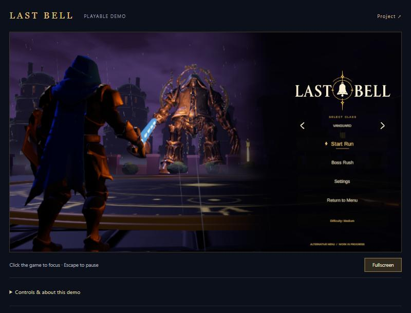
