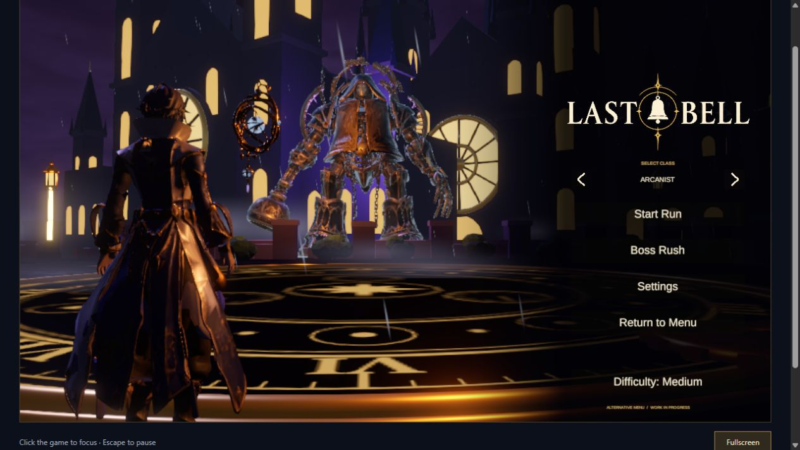

# Current player release — October 23, 2026

Risxhb designated the combined Last Bell player as the development baseline and requested publication of both the source and existing browser demo. Future boss, arena, character, combat, menu and audio changes must integrate into this same player. [Current-player setup](current-player.md) and the repository `AGENTS.md` record that direction.

## Source and assets

The combined source was pushed to `feature/confrontation-menu` at `fac8a13146ecd07b0a4f6aa40c1b6d18acd32088`, followed by browser arrow fix `f0845cb` and this release evidence. [PR #72](https://github.com/Risxhb/collab/pull/72) targets `main` and remains open for integration review; publication does not imply a merge or human gameplay acceptance. It brings together the existing run loop, five arenas, four bosses, three classes, both menus and browser adapters.

New profiles default to Alternative Confrontation; existing saved Settings > UI choices are respected. Select Class is directly above Start Run. Its previous/next icons now use canvas geometry instead of text glyphs, so they render in WebGL as well as Windows. Existing class callbacks and navigation remain in place.

Boss music continues through clears, results and retry preparation. Starting the next fight crossfades into its boss track over the actual countdown, reaching full saved volume at zero. Returning to the main menu resumes the three-track menu playlist. See [music implementation and validation](music-transitions.md).

The immutable [current-player-assets-v1 release](https://github.com/Risxhb/collab/releases/tag/current-player-assets-v1) supplies the generated Brass Foundry assets/scenes, `MainMenu2.wav` and original metadata. Its 210 files / 107 metadata files occupy 43,806,372 bytes; SHA-256 is `af7d454d489fd6efbdb54f94898a3f74bb25cf46b793def159ecfbab8e0d3080`. A downloaded release copy passed checksum verification. Run `setup-assets.cmd` before opening Unity. The existing Sylvara pack remains required and unchanged.

## Validation

All builds used Unity 6000.6.6f1. The final Windows and WebGL builds each succeeded with **0 errors / 46 warnings**; warnings remain recorded in local build evidence. No claim of warning-free compilation is made.

- Final Windows player: [106 menu checks passed, zero runtime errors](validation/current-player-windows-20261023.txt), including all classes, four resolutions, saved menu switching, run return and persistent owner cleanup. Actual captures show both drawn arrows.
- New-profile and saved-profile startup probes passed independently: [fresh profile](validation/current-player-fresh-profile-20261023.txt), [saved profile](validation/current-player-saved-profile-20261023.txt).
- The preceding music implementation passed [83 focused checks](validation/music-transitions-20261023.txt) and [122 three-class/four-boss flow checks](validation/music-flow-20261023.txt), zero runtime errors. The final arrow-only UI change does not alter those audio/run paths.
- All eight build scenes have no unresolved serialized GUID references against tracked metadata, the two asset packs and declared cached Unity packages: [reference report](validation/current-player-scene-references-20261023.json). This is a reference inventory, not a clean-checkout compilation claim.
- Final WebGL package: 13 files / 380,361,881 bytes; six SHA-256/length-verified data parts, 370,599,764 compressed data bytes, 445,711,674 expanded bytes. Gzip integrity passed and each individual file is below the Pages file limit. [Package inventory](validation/current-player-web-package-20261023.json).
- Actual local browser: both arrows visible; next cycled Vanguard, Chimesinger and Arcanist; previous returned to Chimesinger. No console errors observed.

Diagnostic boss defeat verifies routing and music state transitions. Natural full-run victories, balance, human listening and visual acceptance beyond the user's menu approval remain separate.

## Browser publication

The generated build is live under the existing [Last Bell demo](https://risxhb.github.io/lastbell/), Pages commit `b2680db3af049d0a628d4efb4fd9b6dce8d896db`. The Pages build reports **built**, and deployment run `40030755361` completed successfully. Fresh HTTPS requests match the final six-part manifest and all six file lengths. Framework and WASM match byte-for-byte; HTML, CSS and loader match after Git's Windows-to-LF text normalization. [Public file report](validation/current-player-public-package-20261023.json).

The actual public browser loaded the complete game, rendered both class arrows and changed from Chimesinger to Arcanist when Next was clicked. No console errors were observed. The local browser also verified Previous and all three classes. The prior public selection was restored after the check.

All 360 unrelated tracked site files were hash-checked and preserved. Unrelated Unity rendering/project edits, recovery files, the old launcher deletion and a later incoming menu build-helper inspection edit remain outside this source change. Validation describes the release built before that later edit.

Local full evidence is under `E:/Collab/build-evidence/main-player-release-20261023/`; published validation files omit editor licensing/session logs. Earlier failed and superseded runs remain in local evidence. No collaborator messages or board/wiki posts were sent as part of this publication.
