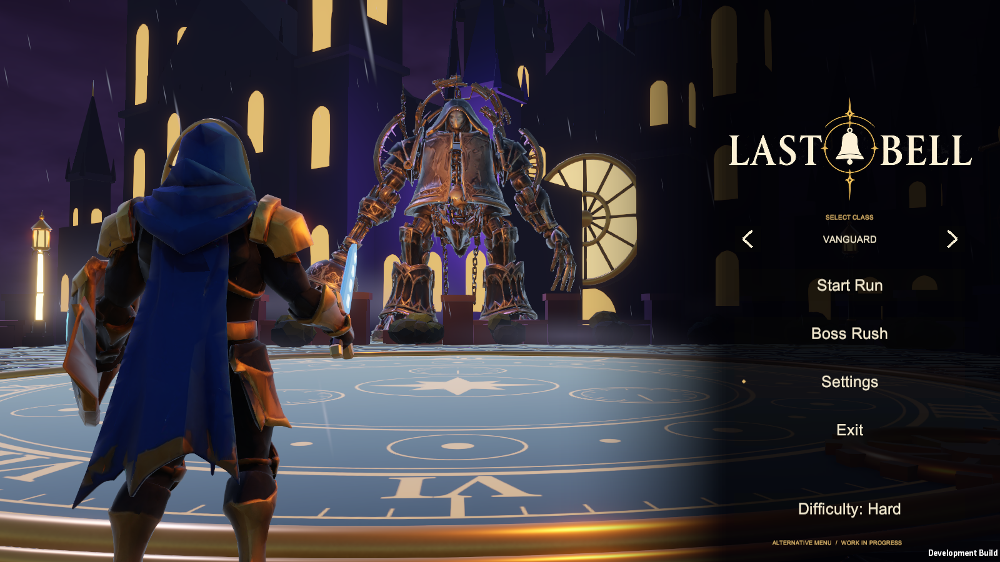

# Current main player — October 23, 2026

Risxhb's direction: **this is the current main player; all modifications to bosses, arenas and the rest of the game must be made to this player.**

The published source baseline is `feature/confrontation-menu`, combining the run loop, all five arenas, four bosses, three classes, both menus, browser adapters, saved hero/menu choices, updated Select Class order and boss music through results with countdown crossfades. Integrate future content work into this baseline. The PR into `main` is the route for promoting the combined source; an open PR must not be described as merged. Existing content owners and their separate branches retain their work.

## Open and build

1. Clone or update this source baseline and run `setup-assets.cmd` **before opening Unity**. It restores original metadata for packed generated arena assets and Sylvara.
2. Open `unity/` with Unity **6000.6.6f1**. Use `Assets/LastBell/Menu/ConfrontationMainMenu.unity` for the main menu presentation. `ShowcaseMainMenu.unity` remains the startup router/build entry, which selects Alternative for a new profile and respects an existing saved choice.
3. Build **Last Bell > Current Player > Build Windows Player**, then use `Play Last Bell.cmd`. Default output is `unity/Builds/Player/LastBell.exe`. `LASTBELL_WINDOWS_OUTPUT` can select an absolute output for an existing local installation.
4. Build the same game for browsers with `LastBell.Menu.EditorTools.WebDemoBuild.Build`, using the matching Web Build Support module and a separate build checkout. It includes the same menu/run scenes. Publish its output only to the existing [`/lastbell/` demo](https://risxhb.github.io/lastbell/).

Boss/arena changes belong in the existing Unity encounters, areas and RunMaps flow and must remain reachable from this menu, class selection and practice setup. Do not use the legacy direct Run-scene build as the primary delivery. Keep existing scene metadata, saved settings, player controls, menu return and music behavior. Generated asset packs are versioned and immutable; update the pack when its referenced assets intentionally change.

## Current acceptance

The final Windows player passed 106 menu checks with visible class arrows and zero runtime errors. The preceding music implementation passed 83 focused music checks and 122 three-class/four-boss flow checks, also with zero runtime errors. The current release adds consistent new-profile menu defaults, portable Windows build output and font-independent class arrow icons for WebGL. Final Windows and WebGL builds each succeeded with 0 errors/46 warnings; separate new-profile and saved-profile startup probes passed. See the [release report](current-player-release-20261023.md) for source, browser publication and validation evidence. Boss progression in diagnostics uses the existing defeat hook; human feel, listening and natural full-run acceptance remain separate.

The immutable [current-player-assets-v1 pack](https://github.com/Risxhb/collab/releases/tag/current-player-assets-v1) includes 210 files and 107 original Unity metadata files (43,806,372 bytes; SHA-256 `af7d454d489fd6efbdb54f94898a3f74bb25cf46b793def159ecfbab8e0d3080`). The manifest installs it automatically with `setup-assets.cmd`.

See [menu preferences](menu-preference.md), [music transitions](music-transitions.md), [showcase](showcase.md) and [browser build details](web-demo.md). The generated demo and source Git commits are distinct artifacts; deployment does not merge a source PR.
