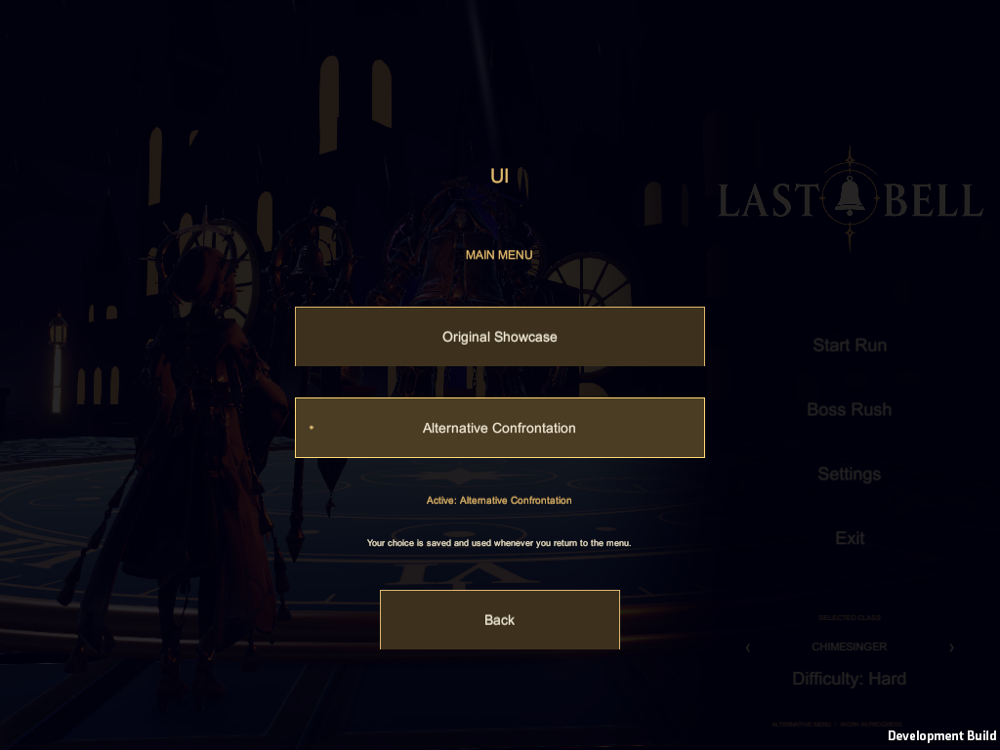

# Saved main-menu preference — October 23, 2026

Choose **Settings > UI > Main Menu** in either menu. **Alternative Confrontation** and **Original Showcase** switch immediately and save the preference. The alternative is selected for the current local user. It remains the sole active menu after gameplay, class-selection/practice exits and application restart until explicitly changed in UI settings.

`MenuAppearance` stores `LastBell.Menu.Style` in PlayerPrefs and owns menu routing. Normal startup remains the first build scene, but its Awake guard redirects to the saved menu before constructing its UI/showcase. The alternate has the same guard. Switches use Single scene loads; there is one active menu and one persistent music owner. Existing class/difficulty preferences and original showcase/music controls remain intact. Explicit old diagnostic flags continue to exercise their original showcase fixtures without overwriting the user's saved preference.

Both menus expose the same `MenuAppearancePanel` UI subpage, with current-choice text and keyboard/controller focus. Back/Escape returns to Settings. Run return, class-selection Back, test-rush menu and WebGL menu return resolve the same saved destination. Normal Windows/Web build helpers include both scenes; the alternative scene is appended to EditorBuildSettings without reordering existing scenes. Standard workspace Play and Showcase launchers now open the combined preview player and honor the saved choice. The historical Menu Flow diagnostic launcher is preserved.

Validation: final Unity 6000.6.6f1 Windows build **Succeeded, 0 errors / 46 existing warnings**. Exact rendered player **106 passed / 0 failed, zero runtime errors**: original class/animation/framing/navigation/music checks, all three run/class returns, UI category in both menus, modal Escape/Back, switching and saving both directions, opposite-startup-scene redirection, one loaded scene/menu and one music owner. A separate fresh process, without the test's selection override, confirms the saved Alternative is restored from the normal startup scene. Screenshots were visually inspected for the Settings entry and both UI pages at 1024×768. This follow-up did not rerun Editor Play Mode, WebGL or live deployment; the earlier Editor SkywardSpire prefab OnValidate limitation remains documented in the main alternative-menu report.

[Windows checks](validation/menu-preference-windows-20261023.txt), [fresh-process restart check](validation/menu-preference-restart-20261023.txt). Full local evidence and pre-task backups: `E:/Collab/build-evidence/menu-preference-20261023/`.

Completed: persistent choice, shared UI settings, all menu return/startup paths, build scene inclusion, common launchers, rendered validation and restart proof. Next: user playtest. Blocked: no local implementation/Windows blocker. Source and wiki remain local; no public post, upload or deployment.
