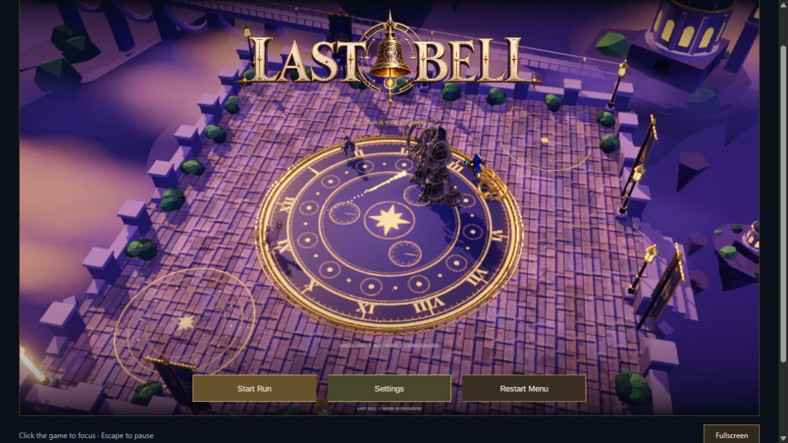
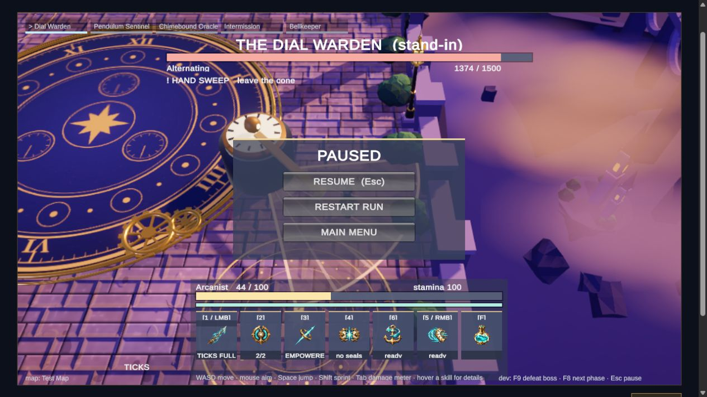
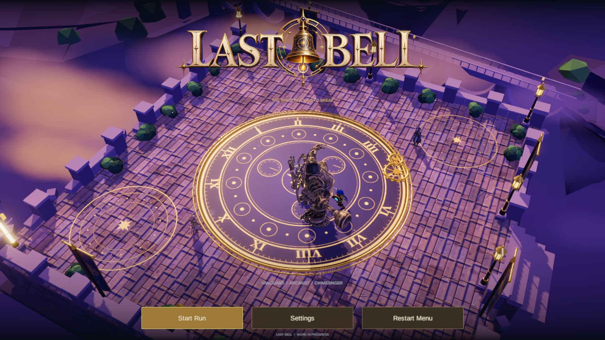

# Browser demo validation — October 21, 2026

## Completed

Unity 6000.6.6f1 WebGL build of the local main-menu demo (`957dd26` plus this PR's browser adapters): **Succeeded, 0 errors, 22 warnings**. Existing generated Brass Foundry assets were copied into the isolated build checkout; the working Unity checkout was not edited. The latest upstream run-loop/difficulty changes were not merged into this release.

Actual rendered Chromium/WebGL checks:

- Click-to-load completes and the animated cinematic menu remains open. Connected gamepad peripherals no longer navigate or submit in the browser menu; Windows gamepad bindings are preserved.
- Settings opens/closes; music slider visibly changes from 60% to 23%. The audio context resumes. Audible playback was not independently assessed.
- Start Run opens the existing selector; all five maps load: Test Map, Skyward Spire, Brass Foundry, Verdant Chimes, Shattered Hour.
- Arcanist run reaches Ready, Intro, Combat and defeat Results. WASD moves the player with camera follow; aimed basic attacks reduce the Dial Warden from 1500 to 1374 HP and fill Ticks.
- Escape pauses/resumes. Both the Results and Pause main-menu buttons return to the cinematic menu. Two menu/run/return cycles were checked.
- Fullscreen expands the player to 1920 × 1080. No browser console error entries were observed during these checks.

Packaging verification: four parts, **233,940,419 bytes** of compressed data; all SHA-256 hashes and part lengths match; the complete gzip stream expands to **295,731,258 bytes** of Unity data. Eleven published files, all below GitHub's 100 MiB limit. Inline JavaScript passes `node --check`. All original Pages repository paths remain unchanged from `593735c`.

## Limits and next

The browser reports existing stripped/unsupported URP post-processing shaders (Gaussian/Bokeh depth of field, Panini, FSR upsampling); rendering was visually inspected, but a clean shader-log claim is not made. The existing small-window preparation/intro text layout can overlap. No gameplay rules, Run source or exported characters were changed.

This is a browser smoke check, not the full run autotest, all-class/all-boss acceptance, a five-loop soak, audio listening test, mobile support or integration validation against the newer run-loop head. Those existing review tasks remain with their owners. Browser download is approximately 245 MB including the runtime; keyboard and mouse are recommended.

Raw logs and original screenshots: `E:/Collab/build-evidence/web-demo-20261021/` (`build4.log`, `browser-console.json`, `browser-*.png`).

## Previews

