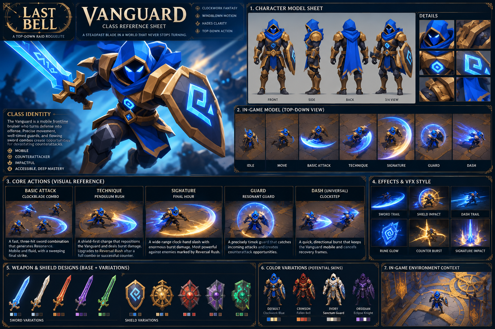

# LAST BELL — Vanguard Class Redesign

**Version:** 2.0 proposal  
**Date:** October 20, 2026  
**Status:** Design proposal for Codex / Claude implementation planning; not verified as implemented  
**Target:** Unity 3D, URP, high-oblique orthographic camera, deterministic 60 Hz combat  
**Inspirations:** *Windblown* (movement, combo flow, offensive momentum) and *Hades* (dash-attacks, compact expressive kit, run builds). Do not copy their assets or proprietary systems.

## Visual reference — blue-and-gold Vanguard (approved direction)



> **Art-direction decision:** Use the **blue hood, glowing cyan eyes and runes, gold-trimmed angular armor, luminous cyan sword, and large rune-marked shield** as the Vanguard baseline. The sheet includes front/side/back/three-quarter turnarounds and high-oblique top-down gameplay mockups. Other colorways and equipment variants are **optional cosmetic concepts**, not approved starting loadouts. This image is a visual reference, **not an authoritative gameplay specification**; use the written specifications below as the source of truth for Clockblade Combo, Pendulum Rush / Reversal Rush, Final Hour, Resonant Guard, universal Clockstep Dash, and Resonance.

For Codex/Claude: keep this PNG beside the Markdown file so the relative image link resolves. Model the baseline character around the blue-and-gold reference, including silhouette, materials, sword/shield, and readable top-down action poses. Treat VFX and skin examples as exploratory; do not derive mechanics or balance values from image labels.

---

## 1. Executive brief

Redesign Vanguard from a stationary tank-like fighter into **The Clockwork Duelist**, a mobile frontline bruiser and precision counterattacker. The player should feel like an aggressive sword-and-shield fighter who turns enemy pressure into offensive opportunities. Keep **four class actions** (Basic, Technique, Signature, Defense) and add **Dash as a universal movement action** available to all classes. Tanking is an optional future role package, not a hard prerequisite.

**Core loop:** Build Resonance with sword combos → reposition or counter → spend Resonance on Pendulum Rush / empowered Reversal Rush → punish boss recovery with Final Hour.

**Design principles:**
- High responsiveness, short recovery-cancel windows, clear facing and directional attacks.
- Boss positioning remains mandatory: guard does not automatically solve a cone/donut mechanic.
- Beginners can succeed with basic combos and dodges; experts optimize counter timing and punish windows.
- Four actions create depth through context and timing rather than an oversized hotbar.
- All values below are **provisional balance targets**, not source-verified runtime values.

## 2. Existing source versus proposal

The supplied `GAME-CONTEXT.md` documents a **legacy Godot solo combat prototype**, not a verified Unity implementation. It has Vanguard Basic (2 damage, 0.4s cooldown, +1 charge), Technique (9 damage, 0.8s cooldown, -3 charge), Signature (18 damage, 6s cooldown), Guard (0.4s duration, 3s cooldown), and a 6-charge maximum. It uses a deterministic 60 Hz simulation and stationary Bellkeeper with alternating Bell Sweep cone and Hollow Toll donut. The new combo chain, universal dash, timed counter, Reversal Rush, relics and role options are **proposed changes**. The supplied Unity art bible describes a **target production direction**, not proof of migration.

Preserve the legacy distinction: a player standing in a resolving danger zone has failed its positioning requirement even if guard or immunity prevents damage. Keep `avoided`, `guarded`, `immune`, and `hit` distinct. Any new precision-counter attack must have an explicit counterable flag; do not award counter success for generic hazard exposure.

## 3. Vanguard combat kit

| Slot | Name | Proposed behavior | Resource / timing |
|---|---|---|---|
| Basic | **Clockblade Combo** | Three fast directional sword hits; third is a broad sweeping finisher. Dash Attack is a lunging slash. | No cooldown; +1 Resonance per successful qualifying hit, max 6 |
| Technique | **Pendulum Rush** | Short shield-first directional charge into sword strike; after full Basic combo or precision counter, becomes **Reversal Rush** with stronger impact and short shockwave. | Costs 3 Resonance; no separate cooldown proposed, but subject to action/recovery constraints |
| Signature | **Final Hour** | Wide golden clock-hand arc with burst damage; benefits from Reversal Rush's temporary exposure mark. | 6s cooldown; no Resonance cost |
| Defense | **Resonant Guard** | Short active defense against designated guardable strikes; precision contact grants Resonance and primes empowered Technique. | Initial target 0.25s active, 3s cooldown |
| Universal | **Clockstep Dash** | Directional evasive burst; can cancel most Basic recovery and chain into Dash Attack. | Initial target 2 charges, 1.2s recharge per charge, 0.20s dash duration |

**Tuning caveats:** Define exact dash invulnerability frames, active guard startup and perfect-counter subwindow, dash distance, attack hitboxes, startup/recovery frames, action priority, stagger, and damage values through playtests. A 0.25s guard active window is a proposal replacing the legacy 0.4s window. Dash immunity should not automatically mark positional mechanics as solved.

### Resonance economy

- Maximum stored: **6**.
- Successful Basic hit: **+1**, counted once per attack action, **not per enemy struck**.
- Successful precision counter: **+1**.
- Pendulum Rush / Reversal Rush: **-3**.
- Final Hour: **0**.
- No Resonance awarded for missed attacks or a non-counterable hazard merely touching Guard.

### Reversal Rush trigger

Complete the three-hit Basic chain **or** achieve a precision counter. This grants a temporary `ReversalReady` state. The next eligible Pendulum Rush within the tuning window consumes the state and becomes Reversal Rush. The empowered strike deals greater damage, creates a short shockwave, and applies a short `ReversalMark` on the target; Final Hour gains bonus damage against marked targets. Exact windows, mark stacking, and bonus percentages are TBD.

### Intended execution tiers

1. **Beginner:** Basic attacks, dodge danger, use Technique at 3 Resonance.
2. **Intermediate:** Finish Basic chain before Technique, exploit boss recovery.
3. **Advanced:** Counter a designated strike, Reversal Rush, then Final Hour inside a safe punish window.

## 4. Movement and combat feel

- Allow limited forward travel during Basic attacks without forced auto-tracking.
- Dash cancels most Basic recovery, but **not** all Signature commitment.
- Dash Attack closes a short gap and retains intentional facing.
- Technique permits limited aim correction during startup; do not snap unpredictably.
- Test ~0.15s input buffering as a starting point.
- Use aim direction from right stick or mouse, with optional modest soft-target assistance.
- Heavy impact comes from poses, audio, hit-stop, and concise VFX, **not sluggish input latency**.
- Use directional melee hitboxes and a shared deterministic action state machine; do not preserve the legacy stationary-boss auto-target model as the final combat design.

## 5. Bellkeeper interaction contract

### Bell Sweep — dodge / positional mechanic

Legacy cone: radius **380** prototype units, half-angle **π/5**, locked to player position at warning spawn with seeded angular variation. Player exits the cone or its radius; dashing around the edge enables quick reengagement. **Guarding inside the cone may mitigate damage according to the chosen rules, but does not count as positional success.**

### Hollow Toll — dodge / spacing mechanic

Legacy annulus: inner radius **155**, outer radius **380** prototype units. The player moves strictly inside the inner radius or strictly beyond the outer radius; boundaries are dangerous. Dashing inward preserves boss proximity and enables a faster punish.

### Pendulum Strike — new proposed counterable boss attack

A clearly telegraphed physical strike flagged `Counterable = true`. A correctly timed Resonant Guard can trigger the precision-counter reward; early or late defense fails to trigger the bonus. The strike remains avoidable by movement. **This attack does not exist in the supplied legacy prototype.**

### General boss rules

- Scripted boss sequences with controlled seeded variations; preserve replayability and readable tells.
- Maintain separate flags for `mechanic_failed`, `damage_prevented`, `counter_success`, and `damage_taken` as needed.
- Do not let guard, invulnerability, or offensive animation accidentally suppress mechanic-resolution logging.
- Keep warning geometry authoritative and rendering synchronized to exact tick-based resolution.

## 6. Roguelite build directions (optional, not rigid classes)

### Bulwark — defense / potential tank package

Perfect counters create brief ally protection; successful protection can reduce Guard cooldown; Reversal Rush can temporarily weaken enemy damage. Co-op protection and targeting require future role-system design.

### Executioner — offensive burst

Reversal Rush creates an echo strike; completed Basic combos temporarily boost attack speed; Final Hour can consume Reversal marks for additional damage.

### Tempest — mobility

Dash Attack gains an extra arc; precisely timed dodges can boost attack speed; Technique can gain a directional follow-up.

These are **run modifiers**, not implemented relics or locked subclasses. Players should be able to mix compatible upgrades. Tank/DPS/Healer role enforcement remains optional and should be layered onto the base kit rather than assumed.

## 7. Controls proposal

| Input | Action |
|---|---|
| Left stick / WASD | Move |
| A / Cross | Basic |
| X / Square | Technique |
| Y / Triangle | Signature |
| LB / L1 | Guard |
| RB / R1 | Dash |
| Right stick / mouse | Aim / facing |

These are **new recommended bindings**, not the legacy Godot control mapping. Provide remapping and keyboard/gamepad parity through Unity Input System.

## 8. Unity architecture and implementation guidance

Target **Unity 3D URP** with real low-poly 3D meshes, XZ-plane combat, and high-oblique orthographic framing. Maintain a **deterministic authoritative 60 Hz C# simulation**; use Animator, VFX, audio, and HUD only as presentation of simulation state/events. Do not use animation events or particles as the authoritative damage clock.

Suggested responsibilities (names are proposals, not verified repository files):

```text
Assets/_LastBell/
  Scripts/
    Simulation/
      CombatSimulation.cs
      VanguardState.cs
      CombatActionResolver.cs
      ResonanceSystem.cs
      DashSystem.cs
      CounterResolution.cs
      HazardGeometry.cs
    Combat/
      VanguardController.cs
      BossAttackDefinitions.cs
    Presentation/
      VanguardAnimatorPresenter.cs
      AbilityVFXPresenter.cs
      HazardTelegraphRenderer.cs
    UI/
      CombatHUD.cs
  Settings/Input/
  Tests/EditMode/
  Tests/PlayMode/
```

**Implementation contracts:**
- Commands carry movement, aim, Basic/Technique/Signature/Guard/Dash inputs and tick identity.
- Simulation owns movement constraints, cooldowns, action states, Resonance, hit tests, counters, marks, damage, and boss hazard outcomes.
- Presentation subscribes to events (attack started, hit, counter, dash, guard, resolution) and never invents outcomes.
- Store tunable abilities in serialized configuration or ScriptableObjects, while keeping authoritative runtime state separate.
- Explicitly define input buffering, cancel windows, attack priority, simultaneous input resolution, and restart semantics.
- Use one documented coordinate mapping when porting legacy 2D geometry to Unity XZ.
- Telegraph visual footprint must match collision math, including dangerous boundaries.
- Keep the first vertical slice solo; avoid introducing multiplayer dependencies before combat feel is validated.

## 9. Implementation order

| Priority | Deliverable | Acceptance target |
|---|---|---|
| P0 | Movement + universal Dash | Responsive directional dash; deterministic charges/recharge |
| P0 | Three-hit Clockblade chain | Correct sequencing, reset rules, Resonance only on successful hits |
| P0 | Pendulum Rush | Costs 3 Resonance, valid directional movement and hit resolution |
| P0 | Resonant Guard | Correct active/cooldown windows; counter only designated attacks |
| P1 | Reversal Rush | Combo/counter primes empowered version; consumes state correctly |
| P1 | Final Hour | 6s cooldown and predictable burst/mark interaction |
| P1 | Bellkeeper integration | Cone/donut positioning preserved; new counterable strike tested |
| P2 | Six starter relics | Meaningfully distinct Bulwark/Executioner/Tempest choices |
| P2 | Optional role package | No mandatory role coupling in base class |

## 10. Verification and acceptance tests

- [ ] Same seed and input commands produce the same Vanguard state/events at 60 Hz.
- [ ] Resonance never exceeds 6 or falls below 0.
- [ ] Basic grants Resonance once per successful attack, regardless of enemy count.
- [ ] Technique is rejected below 3 Resonance without unintended spend.
- [ ] Combo completion and precision counter independently prime Reversal Rush.
- [ ] ReversalReady expiration/consumption and ReversalMark expiration are deterministic.
- [ ] Dash charges, recharge, i-frames and Basic cancel windows match configured ticks.
- [ ] Guard succeeds only in its active window; precision counter only for explicitly counterable attacks.
- [ ] Bell Sweep and Hollow Toll still report failed positioning when guarded/immune inside hazard.
- [ ] Exact cone and annulus boundaries are classified as dangerous.
- [ ] Damage mitigation and mechanic completion are separately represented in events and HUD.
- [ ] Restart clears dash charges/timers, combo state, marks, Resonance, effects and hazards appropriately.
- [ ] Inputs feel responsive on keyboard and controller at target gameplay camera.
- [ ] No VFX obscures critical telegraph boundaries; grayscale/reduced-effects modes remain legible.
- [ ] Boss punish windows allow strong play but do not permit unbounded permanent stun or guaranteed safe damage.

## 11. Decisions to tune before production lock

1. Exact hit damage, startup/recovery/cancel frames, combo timeout, hit-stop.
2. Dash distance, i-frame interval, recharge model, and whether two charges recover sequentially.
3. Guard angle, blockable damage types, precision-counter subwindow and failure penalty.
4. ReversalReady lifetime, ReversalMark duration, stacking and Final Hour damage bonus.
5. Directional targeting and aim assist strength.
6. Whether role-based aggro/protection is enabled; keep it modular.
7. Actual Unity editor version, package versions, gamepad mappings and world-unit scale.

## 12. Instructions for Codex / Claude

> Read this file as a **proposed gameplay specification**, not as a statement of current code. First inspect the actual repository and identify whether the current game is still the legacy Godot prototype or has a Unity migration. Report discrepancies before editing. If Unity is present, implement the smallest testable vertical slice of the Vanguard redesign, beginning with movement, Dash, three-hit Basic, Resonance, Pendulum Rush and timed Guard. Keep deterministic 60 Hz simulation and presentation separate. Preserve mechanic-failure versus damage-mitigation semantics. Do not silently add role-based aggro, networking, or unrelated content. Add automated tests for resource, timing, counter eligibility and hazard outcomes. Summarize modified files, decisions, remaining tuning variables and how to run verification. If Unity is absent, propose a migration plan and ask for approval before creating a new engine project.

## 13. Related project documents

- `GAME-CONTEXT.md` — legacy implementation and exact hazard/outcome rules.
- `LAST-BELL-UNITY-CLOCKWORK-FANTASY-ART-DIRECTION.md` — Unity URP visual target and readability requirements.
- `README.md` / `STARTER-PROMPT.md` — project context and source-of-truth conventions.

**Final design thesis:** Vanguard is an accessible, aggressive sword-and-shield counterattacker whose mastery comes from **pressure, precision, and punishment**, not passive tanking.
